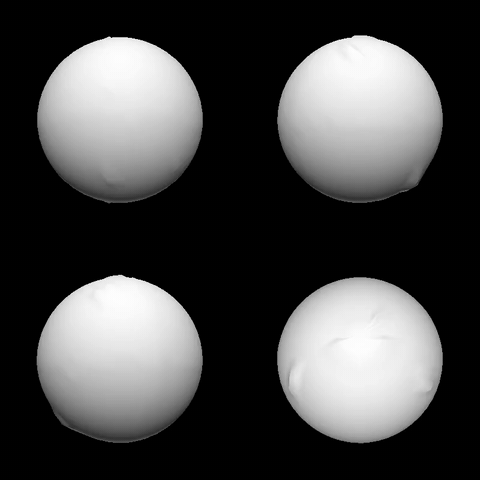

# Differentiable Mesh Rasterizer

A soft rasterizer (SoftRas-style) written in C++ from scratch. Instead of a hard inside/outside test, each triangle contributes a smooth sigmoid of its signed distance to every pixel, and those contributions are blended across faces, so the rendered image is differentiable with respect to the vertex positions. Given renders of a target mesh from multiple cameras, I start from a sphere and optimize its vertices with the gradients of the image loss until it matches the target. This repo is the sequential CPU starter code and serves as the baseline for comparison. Still missing texture optimization, but that's probably it for the CPU side.

This is my final project for 15-618. The plan is to make it much faster in CUDA: parallelize the forward and backward passes, batch across views, and write optimized and fused kernels, including the gradient accumulation. I also want to move the rest of the pipeline to the GPU (Laplacian smoothing, the losses, the optimizers) and use CUDA graphs to cut launch overhead per iteration. For multi-GPU, the idea is data parallelism over views. Everything gets benchmarked against this sequential version.

## Demo

Optimizing the demon mesh from a sphere (full video: [views_grid.mp4](data/demon/opt_views/lambda_420/views_grid.mp4)):

